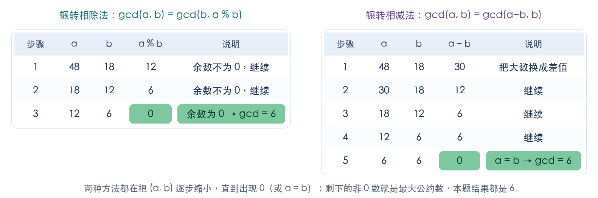
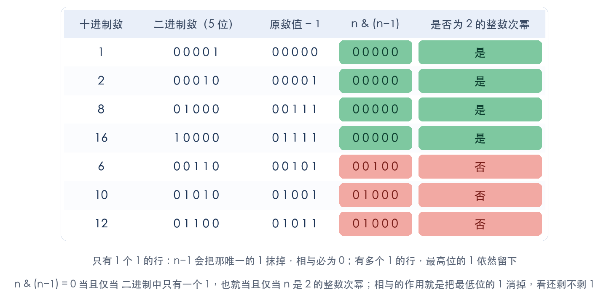
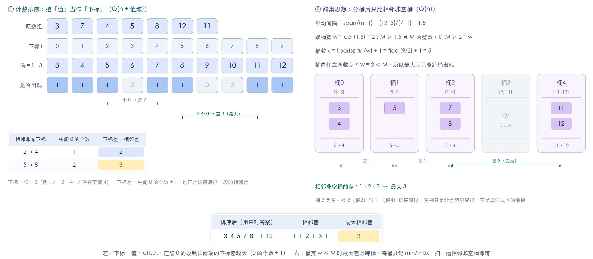
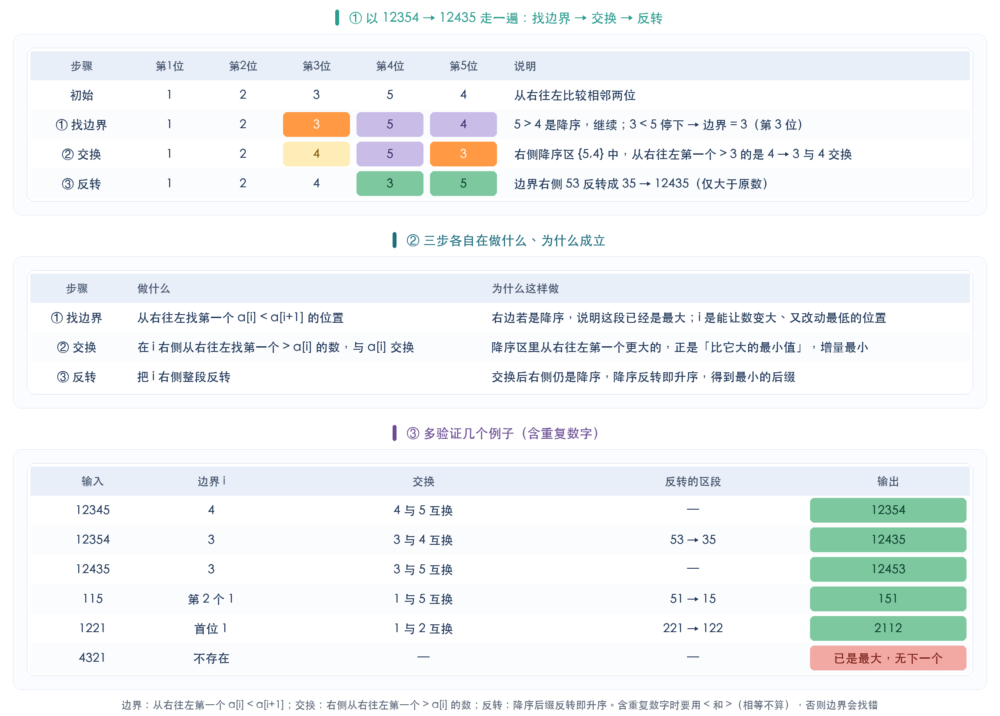
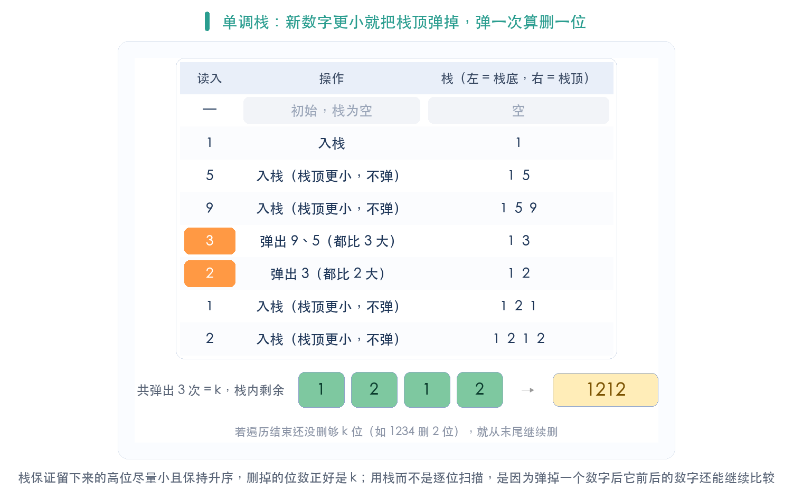
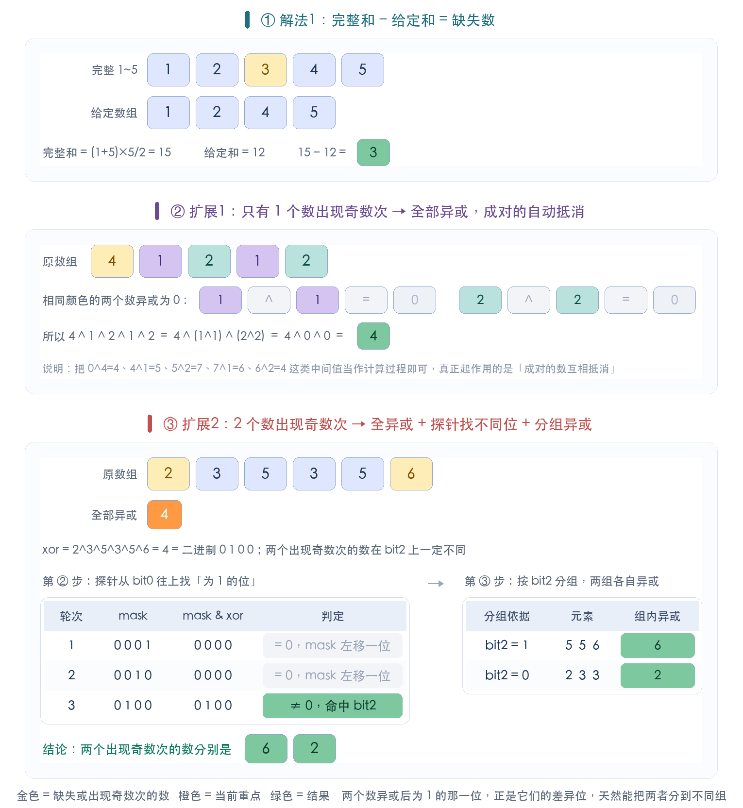

# 如何求出最大公约数
```
辗转相除法：两个正整数（a>b）,他们的最大公约数等于a除以b的余数c和b之间的最大公约数
辗转相减法：两个正整数（a>b）,他们的最大公约数等于a和b的差值和b之间的最大公约数
```



# 如何判断一个数是否为2的整数次幂
```
位运算：1 & 1 = 1 其余都为0 
如果一个数为2的整数次幂,则该数的二进制表示中只有一个1 
则该数与该数减1的与操作结果为0

```



# 无序数组排序后的最大相邻差
```
在给定的数组内无重复数字时：
计数排序思路：给定一个数组,长度为最小值与最大值的差+1,位移为最小值的差
            按照对应下标给数组赋值,连续0的最大长度+1则为最大相邻差
           （也是遍历数组,计算出值为非0的对应下标的最大差值）
桶排序思路：按照数组长度设置桶数量k
          按照w=max-min/（k-1）设置桶宽（数组的平均间隔能够保证最大相邻差的 数据不落在同一个桶内
          记录每个桶内的最大值和最小值,记录当前桶.min-前一个非空桶.max
          数值最大的差即为原数组排序后的相邻最大差值

```



# 寻找全排列的下一个数
```
给出一个正整数,找出这个正整数所有数字全排列的下一个数
翻译：在一个整数所包含的数字的全部组合中,找到一个大于且仅大于原数的新整数
如果输入12345 则返回12354
如果输入12354 则返回12435
如果输入12435 则返回12453

解题思路：
从后向前查看逆序区域，找到逆序区域的前一位,也就是数字置换的边界
让逆序区域的前一位和逆序区域中大于它的最小的数字交换位置
把原来的逆序区域转为顺序状态
```



# 删除K个数字后的最小值
```
给出一个整数,从该整数中去掉k个数字,要求剩下的数字形成的新整数尽可能小。应该如何选取被去掉的数字?
1 593 212 ----- 1212
3 020 0   ----- 200
10        ----10

解题思路：删除k个数字后应该使高位值顺序排列 而非逆序,如果发现高位值为逆序,则应该删除
        使用栈来存储最终保留的数字,可以使某个高位数字被删除后,其前后的数字还可以再次比较,而非遍历整个字符串
```



# 寻找缺失的数字
```
在一个无序数组里有99个不重复的正整数,范围是1 ～ 100，维度缺少一个 1到100中的整数,如何找出这个缺失的整数

解题思路:
解法1:100个数字之和 = （1+100）* 50 / 2  - 99个数字和  

问题扩展1：一个无序数组里有若干个正整数，范围是1～100，其中99个整数都出现了偶数次，只有一个整数出现了
        奇数次，如何找到这个出现奇数次的整数

异或运算:相同为0  不同为1 
解题思路：使用异或运算即可

问题扩展2:一个无序数组里有若干个正整数，范围是1～100，其中99个整数都出现了偶数次，只有2个整数出现了
        奇数次，如何找到这个出现奇数次的整数

解题思路： 两个整数出现奇数次,那么对其分组，在不同组中可以按照问题扩展1的思路求解
         如何对其分组？
         步骤一：两个奇数A与B（A不等于B）异或后必有1位为1
         步骤二：探寻为1的那一个bit位,以该位作为分组的依据
         步骤三：探寻方式为 探针上移
         从bit = 1开始,如果异或后的结果 & bit = 1,则该位为目标bit位
         否则 bit <<= 1 (即10 100 不断左移的方式寻找目标bit位)

```


