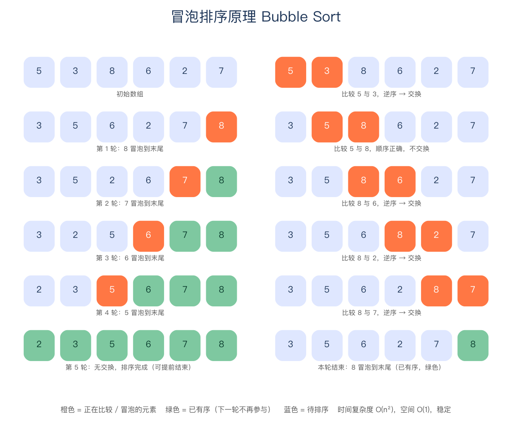
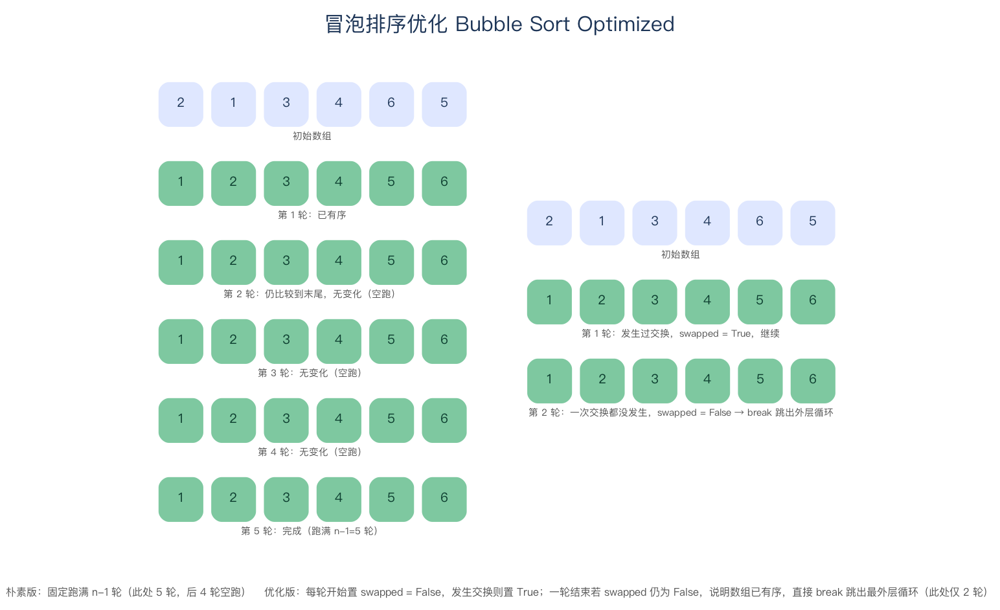
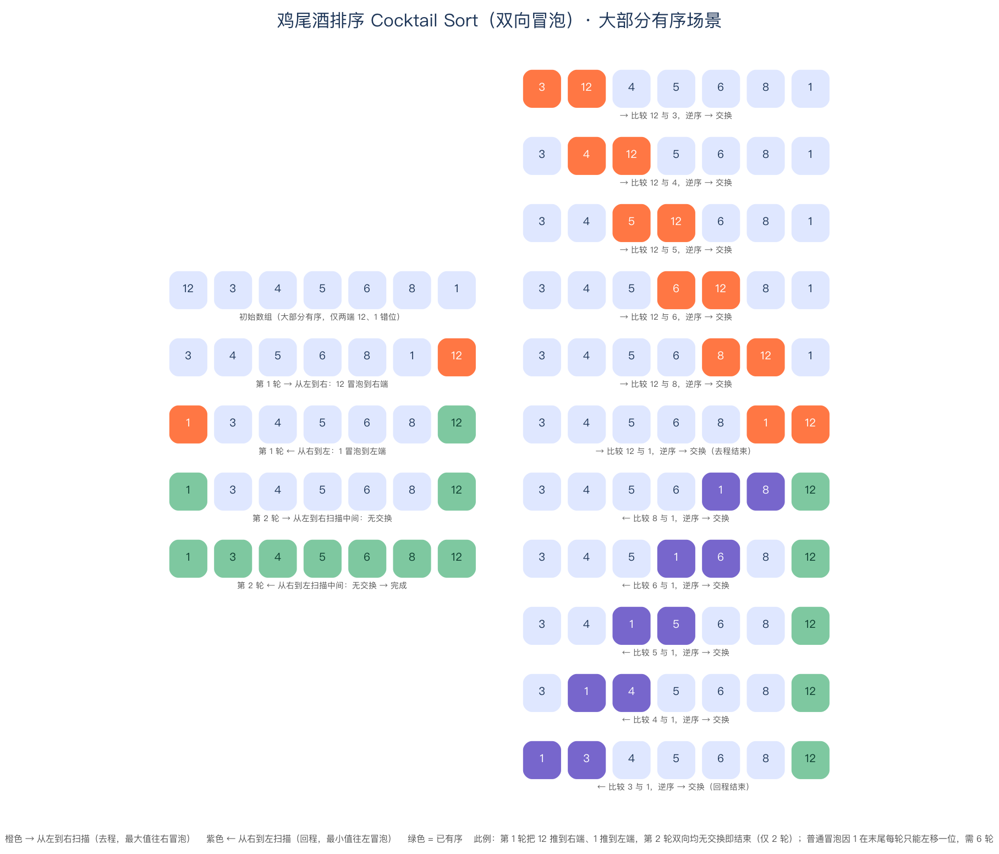
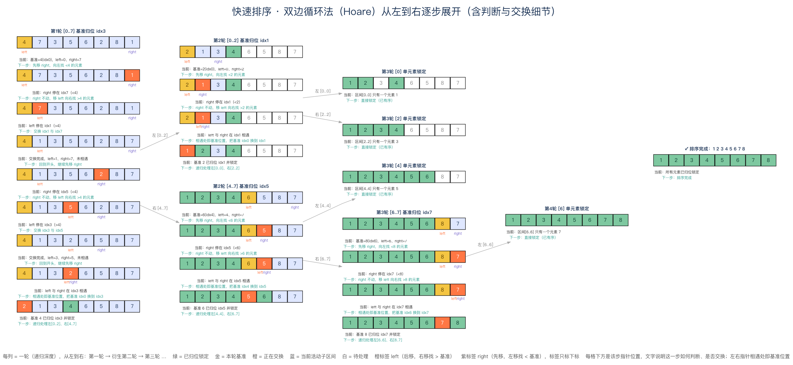
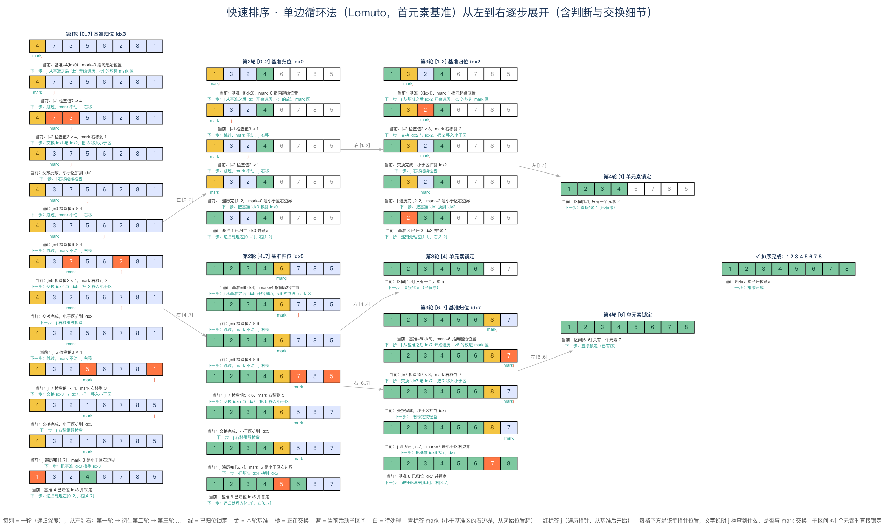
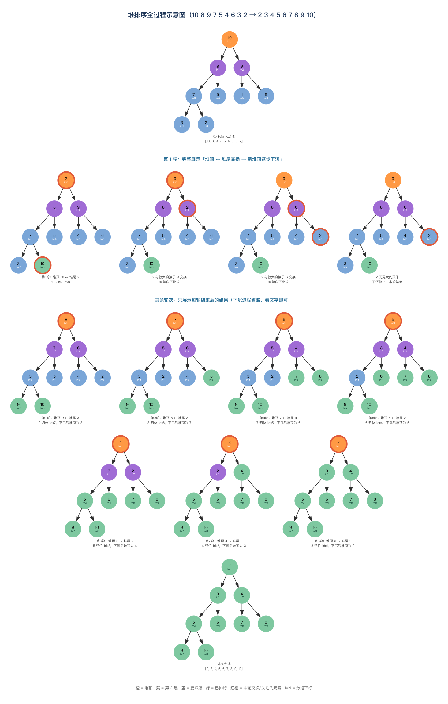
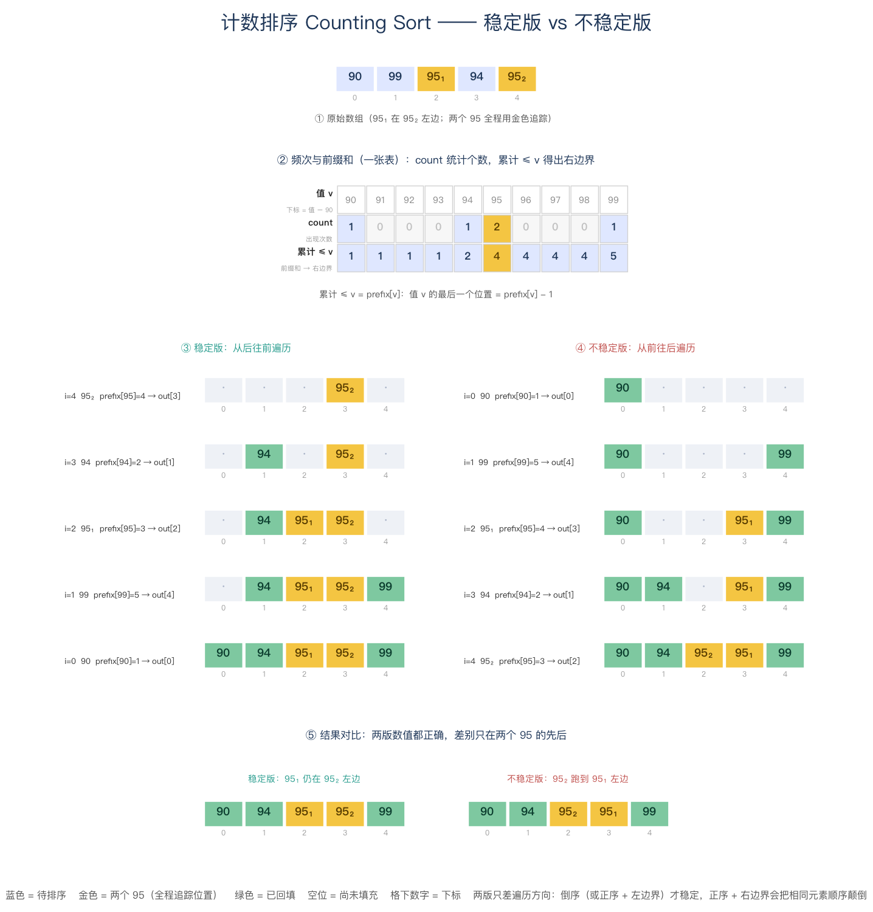
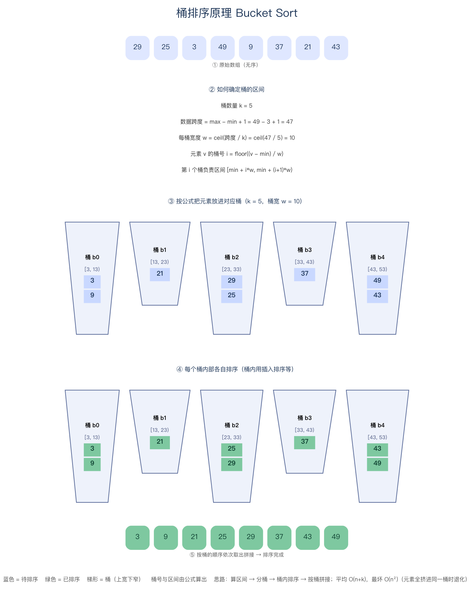

# 目录
[TOC]

# 时间复杂度为O(n^2)的排序算法
## 冒泡排序
- 冒泡排序原理

- 冒泡排序优化

- 鸡尾酒排序


## 选择排序
## 插入排序
## 希尔排序
# 时间复杂度为O(nlogn)的排序算法
## 快速排序
- 概念
>同冒泡排序一样,快速排序也属于交换排序，冒泡排序每一轮冒出一个最大或最小的元素在数列的一端，而快速排序则在每一轮挑选一个基准元素，并让其他比他大的元素移动道数列一边，比他小的元素移动到另一边，从而把数列拆解成两部分(所谓的分治思路)
- 基准元素的选择
>a.最简单的方式是选择第一个元素作为基准元素，但是如果有一个原本逆序的数列希望排序成顺序，那么快速排序时间复杂度就退化成O(n^2)
>b.为了尽可能减少上述情况,一般选取一个中间值同第一个元素交换,仍然让第一个位置的元素作为基准值
- 元素的交换
  - 双边循环法
  ```
   引入left和right两个指针，rigth指针指向末尾元素，left指向基准元素的下一个元素
   步骤一：先移动rigth指针， right指针一直向左移动，直到遇到比基准元素小的元素，停在该元素上
   步骤二：继续移动left指针，left指针一直向右移动， 直到遇到比基准元素大的元素，停在该元素上
   步骤三：交换left指针和right指针指向的元素
   步骤四：重复步骤一到步骤三，直到rigth指针和left指针相遇
   步骤五：left指针本身所指元素以及其左边的元素都是小于等于基准元素的值，right指针右边都是大于基准元素的值，交换left指针所在位置的元素和基准元素的值，至此，基准元素就放在了正确的位置上
   步骤六：递归地对基准元素左边的子数列和右边的子数列进行快速排序
  ```
    
  - 单边循环法
  ```
  引入mark变量,用来标记有多少个元素小于等于基准元素,初始mark指向基准元素所在位置
  步骤1:从基准元素后遍历,如果遇到比基准元素小的元素,则mark右移,并交换mark指向的元素和当前元素
       直至遍历完全后,mark所在指标位置就是基准元素的正确位置,交换mark指向的元素和基准元素
  ```

    

## 归并排序
## 堆排序
> 把无序数组构建成二叉堆。需要从小到大牌,则构建成最大堆；需要从大到小排，则构架成最小堆
循环删除栈顶元素，替换到二叉堆的末尾，调整堆新产生的堆顶



# 时间复杂度为O(n)的排序算法
## 计数排序
```
计数排序不需要比较元素大小,利用数组下标来确定元素的正确位置
适用于一定范围内的整数排序,在取值范围不是很大的情况下,性能超过时间复杂度为O(nlogn)的排序
计数排序的实现原理是利用数组下标来记录元素出现的次数,最后根据数组下标来确定元素的正确位置

```


## 桶排序

```
每一个桶代表一个区间范围,里面可以承载一个或多个元素
局限性：如果元素的分布不均衡,在极端情况下,第一个桶中有n-1个元素，最后一个桶中有1个元素,此时的时间复杂度将退化为O(nlogn)，而且还白白创建了许多空桶

- 方式1
先确定桶的个数,在确定每个桶的区间范围
桶数量:按照经验值\按照元素个数\元素个数开根号
桶宽:ceil（max-min+1）/k
- 方式2
先确定每个桶的区间范围,在反推桶的个数
- 方式3
按照内存约束
```



