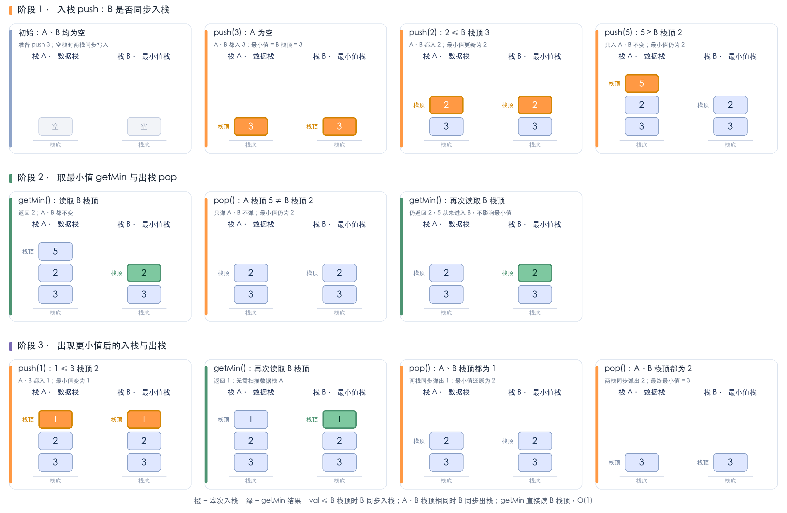
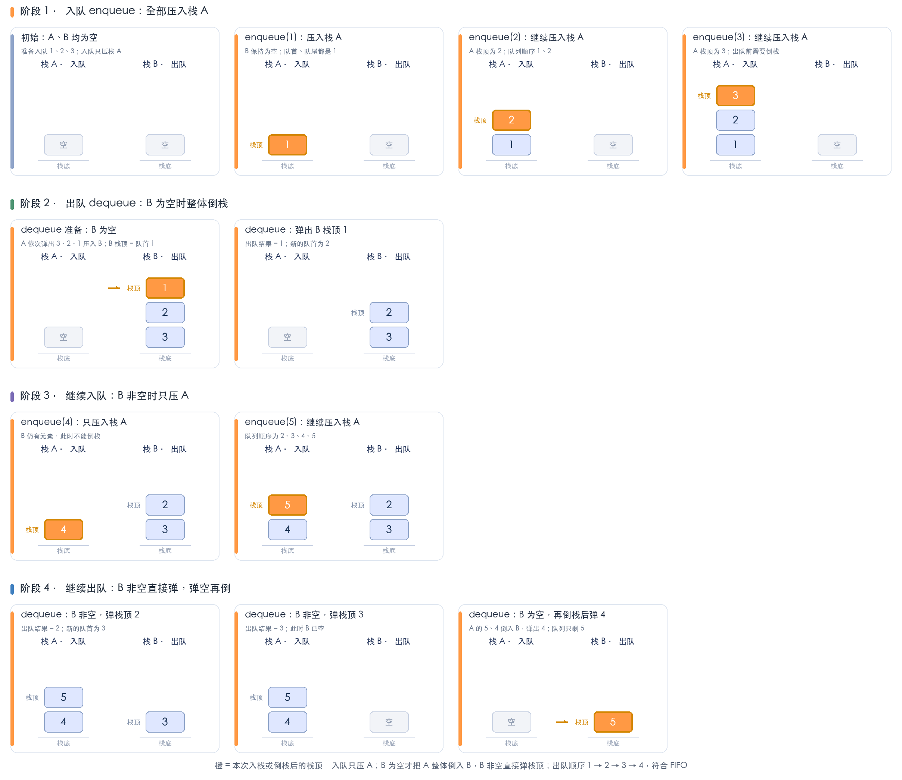

# 实现一个栈,该栈带有三个方法,入栈,出栈,获取最小元素
```
使用一个备胎栈B,用于存储栈中最小的元素
入栈时,如果栈A为空,则将元素入栈A,也入栈B
      如果栈A不为空,则将元素入栈A,如果元素小于等于栈B的栈顶元素,则将元素也入栈B
出栈时,如果栈A的栈顶元素和栈B的栈顶元素相同,则栈B也出栈
获取最小元素时,返回栈B的栈顶元素

```



# 如何用栈实现队列
```
使用两个栈,一个栈A,一个栈B
入队时,将元素入栈A
出队时,栈B为空,将元素A的所有元素出栈,并入栈B,最后将栈B的栈顶元素出栈
      不为空,则栈B的栈顶元素直接出栈
```


