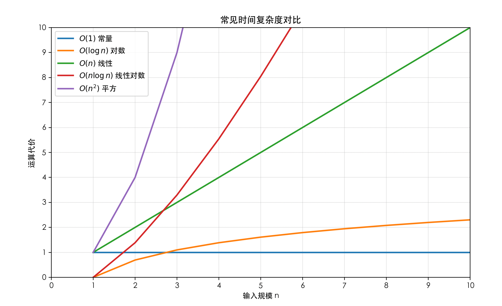
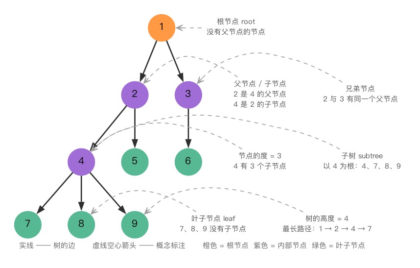
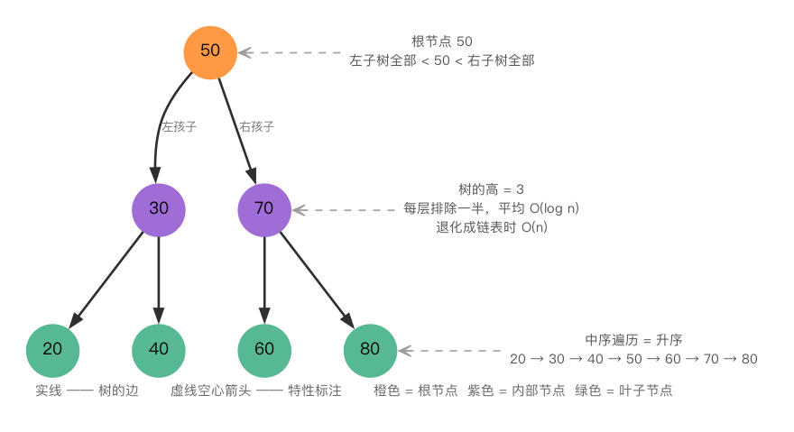
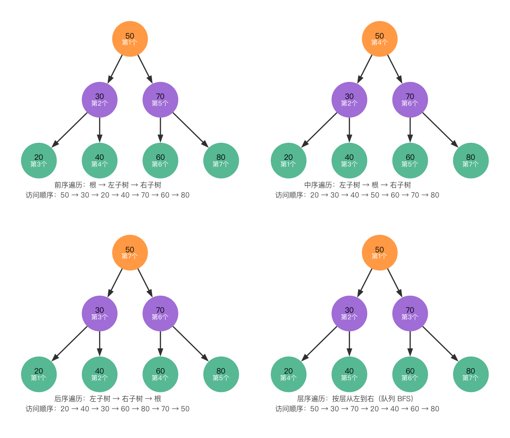
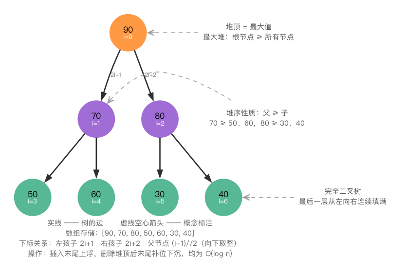
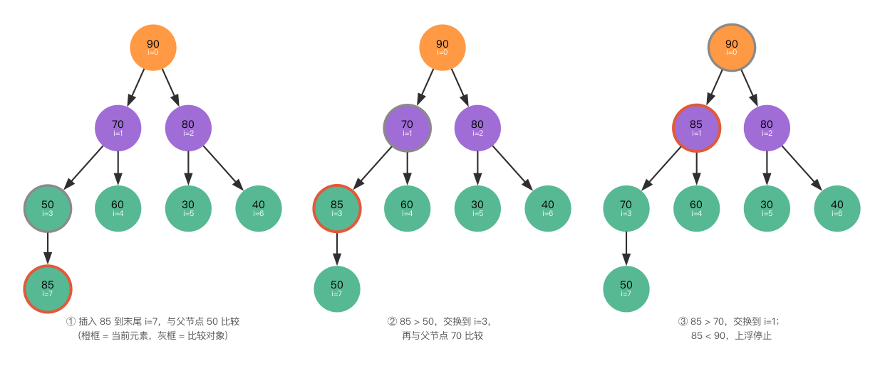
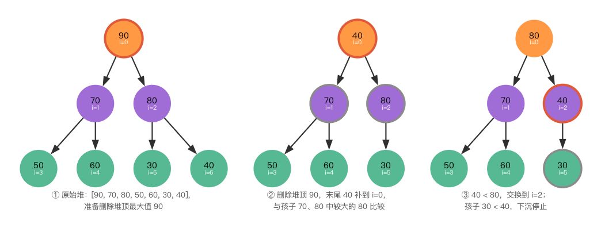

# 目录
[TOC]

# 什么是算法

> 时间复杂度：运行时间的长短
> 空间复杂度：占用空间的大小

算法就是为了解决某一类问题而抽象的一种思维，使用空间复杂度和时间复杂度这两个指标来衡量算法的优劣。

# 算法优劣的衡量

> O(1) 常量时间复杂度
> O(log n) 对数时间复杂度
> O(n) 线性时间复杂度
> O(n log n) 线性对数时间复杂度
> O(n^2) 平方时间复杂度

# 什么是数据结构

>数据结构就是组织、管理和存储数据的格式，其目的是为了高效地访问和修改数据。

## 数据结构概览

| 数据结构 | 逻辑结构             | 物理存储     | 访问方式        | 操作特点              |
| ------  | ---                | ---         | ---            | ---                 |
| 数组     | 线形                 | 顺序存储     | 随机访问 O(1)          | 查改快，增删需搬移 O(n)      |
| 链表     | 线形                 | 链式存储     | 顺序访问 O(n)          | 增删快 O(1)，查找需遍历 O(n) |
| 栈       | 线形（后进先出）     | 可基于数组或链表实现存储 | 仅栈顶可访问           | 限制在一端插入和删除         |
| 队列     | 线形（先进先出）     | 可基于数组或链表实现存储  | 队尾入队、队头出队     | 两端分别处理入队和出队       |
| 哈希表   | 非线性              | 散列存储     | 键值映射，平均 O(1)    | 利用哈希函数直接定位，存在冲突 |
| 树      | 非线性              | 链式存储     | 随机访问 O(1)          | 查改快，增删需遍历 O(n) |

## 树

树的应用无处不在，例如家谱、例如企业中的组织架构、例如文件系统、例如目录结构等
### 概念

### 二叉排序树/二叉查找树

#### 二叉树的遍历算法

### 二叉堆(完全二叉树)

- 二叉堆的性质

>有最大堆，最小堆两种类型。最大堆栈顶元素最大，最小堆栈顶元素最小。优先级队列的实现基于二叉堆。每一次入队操作就是堆的插入操作(又称上浮操作)，每一次出队操作就是删除堆顶节点（又称下沉操作）。

- 入队操作/二叉堆上浮操作

- 出队操作/二叉堆下沉操作

# 附录
1.[代码+动画演示](https://see-algorithms.com/)

2.[纯动画演示](https://algomination.com/array/sliding-window-max-sum)

