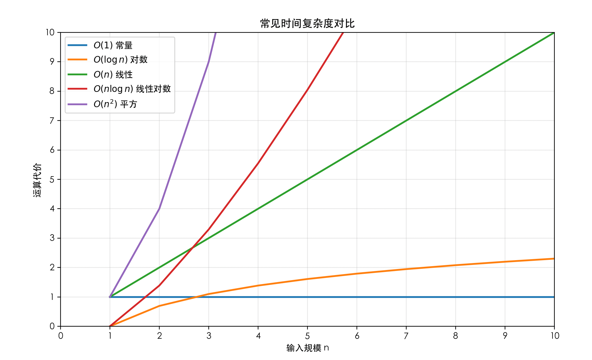

# 什么是算法

> 时间复杂度：运行时间的长短
> 空间复杂度：占用空间的大小

算法就是为了解决某一类问题而抽象的一种思维，使用空间复杂度和时间复杂度这两个指标来衡量算法的优劣。

# 什么是数据结构
>线形结构：列表（顺序存储）,链表（链式存储）, 栈, 队列, 哈希表
>非线形结构：树、图,跳表，哈希链表，位图 

数据结构就是组织、管理和存储格式,其目的是为了高效的访问和修改数据。

# 时间复杂度的排序

> O(1) 常量时间复杂度
> O(log n) 对数时间复杂度
> O(n) 线性时间复杂度
> O(n log n) 线性对数时间复杂度
> O(n^2) 平方时间复杂度

