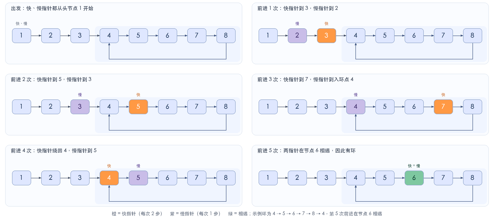
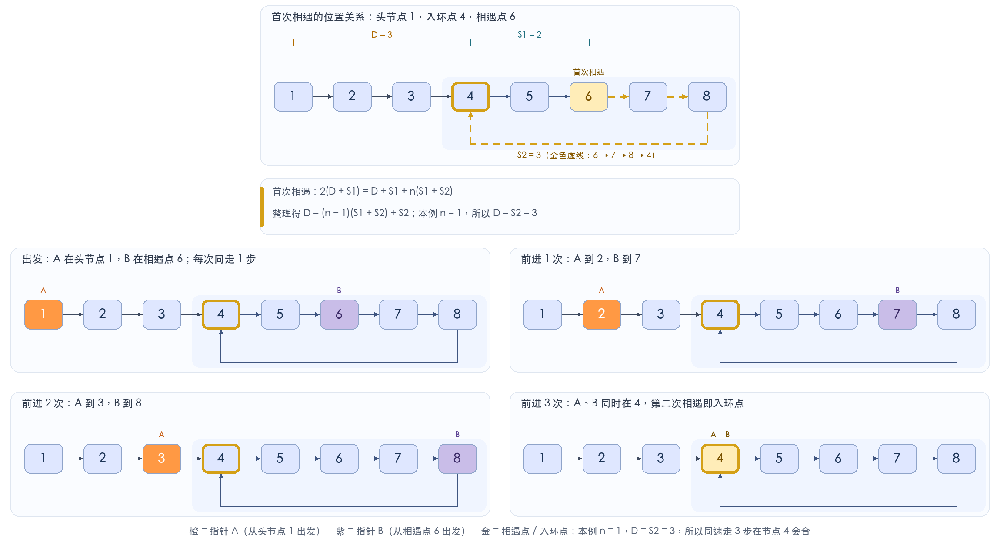
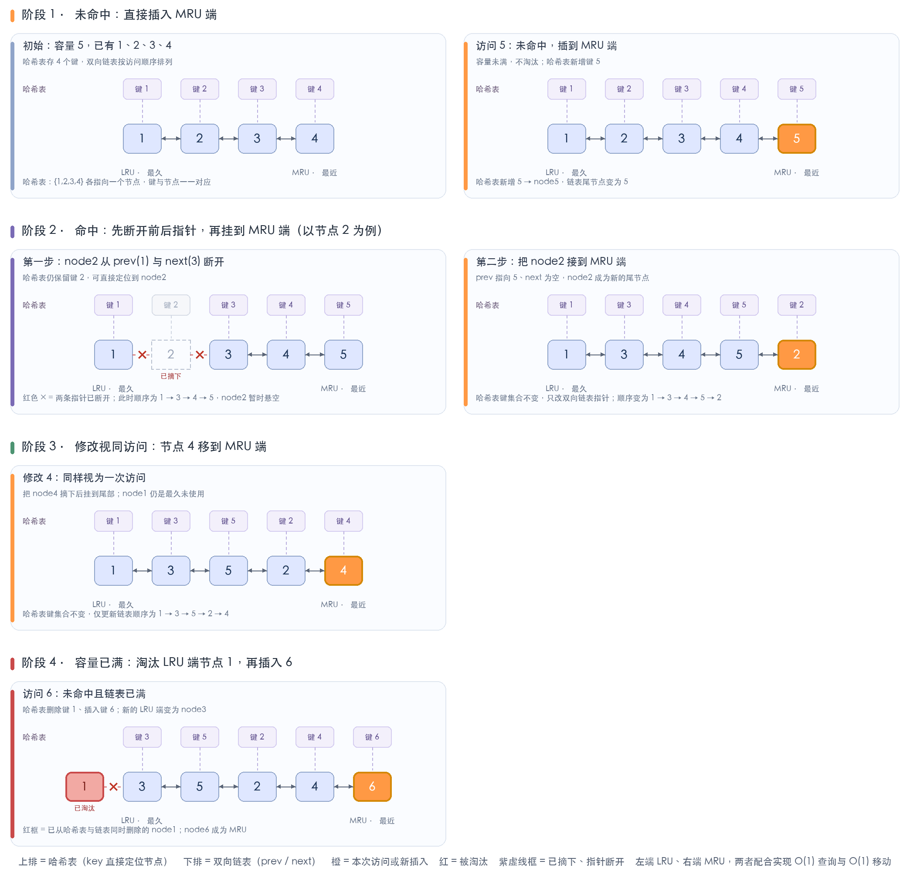

# 如何判断链表是否有环
```
使用快慢指针,如果快指针追上慢指针,则说明有环
此问题类似于奥数中环形赛道的的追及问题
```



# 如何判断环长
```
追及公式:快指针速度 * 时间 -  慢指针速度 * 时间 = 环长
快指针速度设为每次两步,慢指针速度设为每次一步,时间为前进次数
则环长 = 快指针步数 * 前进次数 - 慢指针步数 * 前进次数 
      = (每次两步 - 每次一步) * 前进次数
      =  前进次数
```

# 如何判断入环点
```
两个指针首次相遇所走的距离：前进次数相同,快指针速度是慢指针的2倍
慢指针距离：D+S1
快指针距离 ：D + S1+ n(S2+S1)
快指针速度是慢指针2倍 则 快指针距离 = 2 * 慢指针距离
则 D + S1+ n(S2+S1) = 2 * (D+S1)
则 D = n(S2+S1) - S1
则 D = (n-1)(S2+S1) + S2
在相同时间内,要求两个指针走相同的距离来汇合
指针A从头节点出发,走到入环点,距离为D
指针B从相遇点出发,走n-1圈的环长在走S2的距离也为D
指针A与B要用相同时长走相同的距离,则速度必须保持一致
也就是说 一个指针从头节点走,另一个指针从相遇点走,两个指针每次只走一步,直到再次相遇,则相遇点就是入环点
```



# LRU算法
```
全称 Least Recently Used,最近最少使用算法
哈希表中无所谓顺序
哈希链表每一个节点都有它的前驱节点和后继节点,就像双向链表一样,这样原本无序的哈希表就拥有了固定的排列顺序
思路演示：
1.链表长度为5 从前到后存储了 1 2 3 4个用户的信息（4个节点）
2.业务访问5，链表中5不存在，则将5插入链表末尾 1 2 3 4 5 
3.业务访问2，则将2移动到链表 1 3 4 5 2
4.业务修改4的信息，则将4移动到链表 1 3 5 2 4
5.业务访问6，则链表中6不存在，链表节点已满，则删除最近未使用的节点1 将6 插入链表末尾  3 5 2 4 6
```


